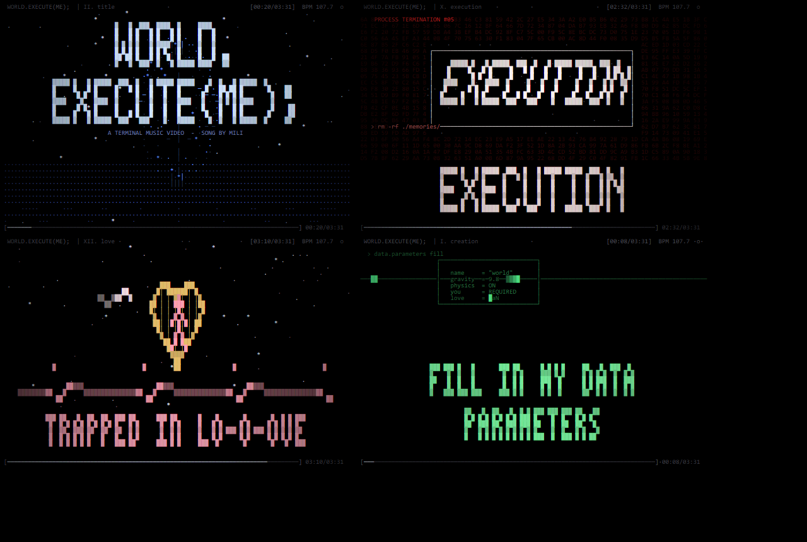

# World.execute(me); — a terminal music video

A fan-made **music video that plays entirely inside your terminal**.
Truecolor ANSI graphics at 30 fps, beat-synced visuals, and a karaoke-style
lyric band — while the song itself plays through the same terminal session.

Song: **World.execute(me);** by **Mili** — listen on
[NetEase Music (id 435278010)](https://music.163.com/#/song?id=435278010)



## Quick start

```bash
pip install pygame
python world_execute_me.py
```

The player looks for `song.mp3` next to the script (not included in this
repo — download it yourself from the link above and rename it to
`song.mp3`). Without the file it still runs as a silent visualizer.

Keys: `q` / `Esc` quit, `space` pause/resume.

Requires a terminal with 24-bit color and UTF-8 (Windows Terminal, PowerShell
on Windows 10+ with VT enabled, mintty, most Linux terminals). Recommended
window size: **100 x 36 or larger**.

On console fonts that draw block glyphs double-width (e.g. CJK bitmap fonts),
the player probes for this at startup and automatically falls back to an
all-ASCII palette; force it with `--ascii`.

## Options

| flag | meaning |
| --- | --- |
| `--no-audio` | visuals only |
| `--start SECONDS` | begin N seconds into the song (seeks audio too) |
| `--av-offset SECONDS` | nudge visuals vs. audio if your output lags |
| `--fps N` | frame cap (default 30) |
| `--volume X` | 0.0 - 1.0 (default 0.9) |
| `--size-w/--size-h` | override terminal size detection |
| `--ascii` | force ASCII glyphs (skip the double-width probe) |
| `--still "20,152,190"` | render single frames to `preview.html` and exit |

> pygame ships wheels for Python 3.9-3.13; on newer interpreters
> `pip install pygame` may fail to build — use a 3.12/3.13 Python for audio,
> or run `--no-audio`.

## The show

Fourteen acts, hand-timed to the lyrics (`lyrics.lrc`):

1. **creation** — boot log, tetromino pieces, `new World(me, you)`
2. **title** — wireframe globe over a synthwave grid
3. **mathematics** — points, circles, sine tangents, infinity, AC/DC
4. **simulations** — a wall of `sim_xxx.exe` windows, `run world.exe`
5. **disguises** — eggplant, tomato, tabby cat, god toggle, F/M, AM/PM, S/M
6. **vibrations** — interference rings, a 100% ring that cracks
7. **isolation** — "You have left" xN: she crumbles pixel by pixel
8. **illegal arguments** — lightning, stack traces, red alert borders
9. **darkness** — error-code rain over a cracked heart
10. **execution** — twelve slamming stamps, a kill feed, ein/dos/trios…, the EXECUTE button
11. **reprise** — stamped windows, a failing `restore`
12. **love** — floating formulas, `LOVE = SUM( you * me )dt`, a Q&A box
13. **alone** — a heart-shaped cage, an ECG flattening out
14. **end** — CRT power-off, credits

Beats and energy come from an offline analysis pass (`assets/timeline.json`,
regenerate with `python tools/analyze.py`, needs numpy + ffmpeg). At runtime
only pygame is required.

## Repo layout

```
world_execute_me.py    the player (renderer + audio + scenes)
lyrics.lrc             timestamped lyrics
tools/analyze.py       offline beat/energy analysis -> assets/timeline.json
assets/timeline.json   precomputed beats, bpm, energy envelope
song.mp3               NOT in the repo — get it from the link above
```

## Notes

- Fan project for fun; all music belongs to Mili and its rights holders.
  Support the artist: <https://music.163.com/#/song?id=435278010>
- Pure Python standard library + pygame; no other runtime dependencies.
- Tested on Windows 10/11 (cmd, PowerShell, Windows Terminal, mintty) and
  should work on Linux/macOS terminals with truecolor support.

Licensed under the [MIT License](LICENSE).
